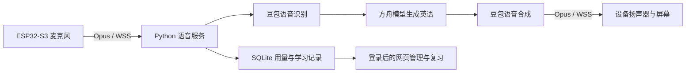

# 英语卡壳？先说中文｜开源 AI 英语学练机

**ESP32-S3 × 豆包 AI：把想说的中文变成英语示范，听完就能开口练。**

English Learning Machine — an open-source ESP32-S3 AI English speaking practice device.

把想说的中文或中英混合表达变成自然英语，听示范、开口练，再通过网页复习。英语学练机是一套可自行搭建的 **AI 英语口语练习硬件 + Python 云端服务**，基于小智开源项目，接入豆包语音识别、方舟语言模型和语音合成。

[English](README.en.md) · [快速开始](docs/quickstart.md) · [硬件接线](docs/hardware.md) · [工作原理](docs/architecture.md) · [常见问题](docs/faq.md) · [项目主页](https://aotefan.github.io/english-learning-machine/)

> 当前版本：面向开发者的原型。日常推荐半双工模式：说话 → 生成英文 → 播放 → 恢复监听。全双工 / AEC 为实验候选，尚未通过长期实机验收。

## 它能做什么？

| 使用场景 | 行为 |
| --- | --- |
| 想说英语，但先想到中文 | 将整句意思表达成英语，尽量保留数量、时间、否定和请求语气 |
| 一句话中夹着中文和英语 | 接受中英混说，生成完整的英语表达 |
| 说出的英文需要纠正 | 提供修正后的英文示范；模型判断已自然正确时可静默结束 |
| 需要练习对话 | 切换到陪练模式，根据说话内容回应 |
| 需要重听、复习 | 设备重播最近实际播放的示范，网页查看表达并记录自评 |
| 希望管理设备和开销 | 网页控制音量、模式、输入方式；设置每日轮数和估算费用上限 |

例如：说「我想再喝一点水」，表达模式的目标输出是 “I'd like some more water.”。这是**说明行为的示例**，不是固定答案或准确率测试结果。表达模式转换你的意思；陪练模式则参与对话。

## 为什么做成一台设备？

按键或自动监听提供直接的语音入口；可选 ST7789 屏幕显示中英文；浏览器负责查看表达、复习和控制设备。适合希望自己搭建英语练习工具的开发者、创客，以及愿意参与配置和使用管理的家庭。

这不是自带教材的商业学习机，也不提供学习效果评分。跟读次数、自评独立表达次数和“需要帮助”次数不能证明语言能力提升。

## 快速开始

需要 Git、Python 3.11 和系统 libopus。云端主链路不需要 Node.js、PHP、GPU 或本地大模型权重。

```sh
git clone https://github.com/aotefan/english-learning-machine.git
cd english-learning-machine
python3 scripts/restore_forks.py
python3.11 -m venv .venv-cloud
.venv-cloud/bin/python -m pip install -r requirements-cloud.lock
python3 scripts/init_private_config.py
.venv-cloud/bin/python scripts/run_cloud.py \
  --env-file .secrets/cloud.env \
  --devices-file .secrets/devices.json \
  --admin-file .secrets/admin.json \
  --state-dir artifacts/local-state
```

默认在 **STANDBY** 模式启动，不调用付费语音或语言模型。打开 <http://127.0.0.1:18001/login>，登录信息保存在本机 `.secrets/admin-login.txt`。联网克隆和依赖安装会下载软件；STANDBY 禁用的是供应商推理调用。

开启真实语音、设置预算、部署 TLS 和连接 ESP32 请按 [完整安装说明](docs/quickstart.md) 操作。未配置设备时，网页显示离线是正常状态。

## 硬件与软件

| 部分 | 当前实现 |
| --- | --- |
| 设备 | ESP32-S3；参考配置使用 16 MB Flash 和 PSRAM |
| 收音 / 播放 | I2S 麦克风、MAX98357A 功放、扬声器 |
| 屏幕 | 可选 ST7789 240 × 240；也有无屏配置 |
| 固件 | 小智 ESP32 / ESP-IDF，C++，WebSocket + Opus |
| 服务端 | Python，基于小智服务端的集成修改 |
| AI | 豆包 Seed-ASR、方舟文本模型、Seed-TTS；需自行开通服务 |
| 管理与复习 | HTML / CSS / JavaScript + SQLite，无前端构建步骤 |

[完整接线表和固件构建](docs/hardware.md) · [服务部署](docs/deployment.md)

## 工作原理



[架构、数据流和模式说明](docs/architecture.md)

## 隐私和使用成本

开源代码采用 MIT；第三方组件仍按各自许可证提供。硬件、服务器和云端 API 费用由部署者承担。

云端模式会把本轮语音传给语音供应商，把转写交给语言模型。原始音频默认不落盘；显式诊断录音例外。学习文字和事件数据库默认保留最近 7 天；运行日志、备份和供应商数据须由部署者另行管理。**开源和自托管不等于语音不出网。** 详见 [隐私说明](docs/privacy.md)。

本仓库不包含任何在用密钥、设备身份、家庭录音、生产日志、数据库或历史部署包。所有示例使用保留域名和占位数据。详见 [安全说明](SECURITY.md)。

## 目录与复现

- `scripts/`：云端服务、设备管理、配置及诊断工具。
- `debug/`：设备控制、复习、费用页面。
- `integrations/`：固定的公开上游版本、许可证和经筛选的源码覆盖文件。
- `tests/`：使用模拟供应商和临时文件的本地测试。
- `deploy/`：容器及 TLS 网关模板；必须配置自己的域名和服务器。
- `docs/`：安装、接线、原理、FAQ 与公开项目主页。

`restore_forks.py` 从公开上游获取指定提交，再应用可直接审查的源码覆盖文件；不会下载私人 Git 历史。生成的 `upstream/` 不纳入本仓库提交。修改覆盖文件后需更新 `integrations/manifest.json` 中对应 SHA-256，参见 [贡献指南](CONTRIBUTING.md)。

## 当前边界与路线

已实现表达 / 陪练模式、自动 / 按键输入、字幕、网页复习、设备控制和预算保护。当前仍需改善噪声环境识别、端到端延迟及长时间运行稳定性。全双工、回声消除和真实双讲仍属实验功能；没有承诺学习效果、识别准确率或固定响应时间。

[验证范围](docs/validation.md) · [FAQ](docs/faq.md) · [贡献指南](CONTRIBUTING.md)

## 开源许可与致谢

本项目新增代码采用 [MIT License](LICENSE)。感谢 [78/xiaozhi-esp32](https://github.com/78/xiaozhi-esp32) 和 [xinnan-tech/xiaozhi-esp32-server](https://github.com/xinnan-tech/xiaozhi-esp32-server)。固件组件、可选模型和语音资产的许可需分别遵守，详见 [第三方声明](THIRD_PARTY_NOTICES.md)。
